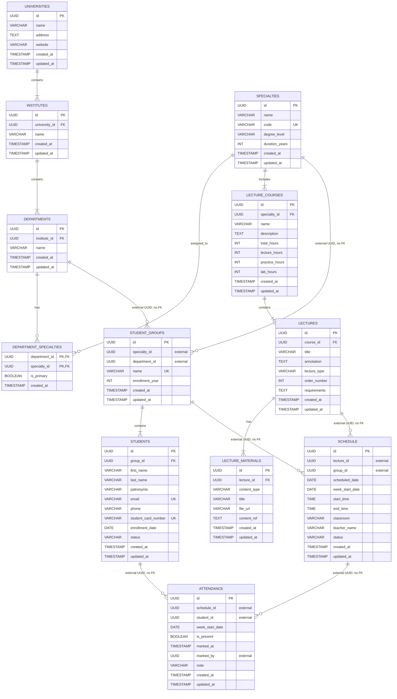
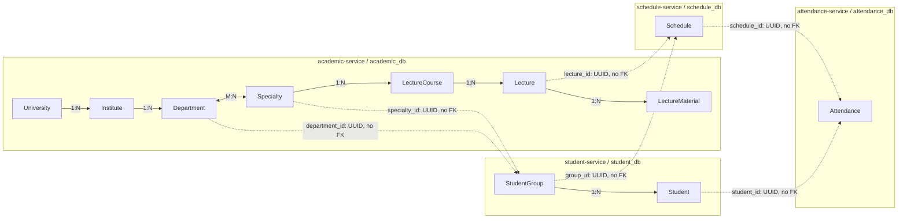
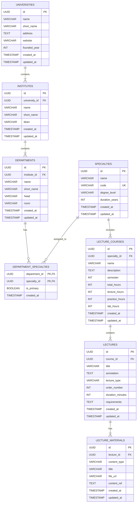
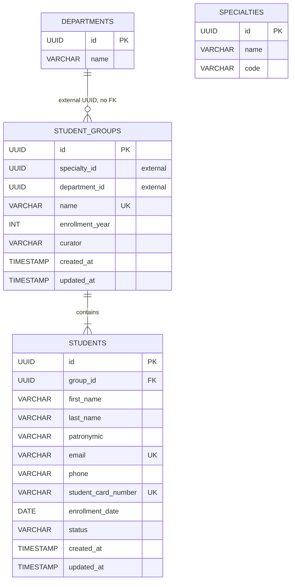
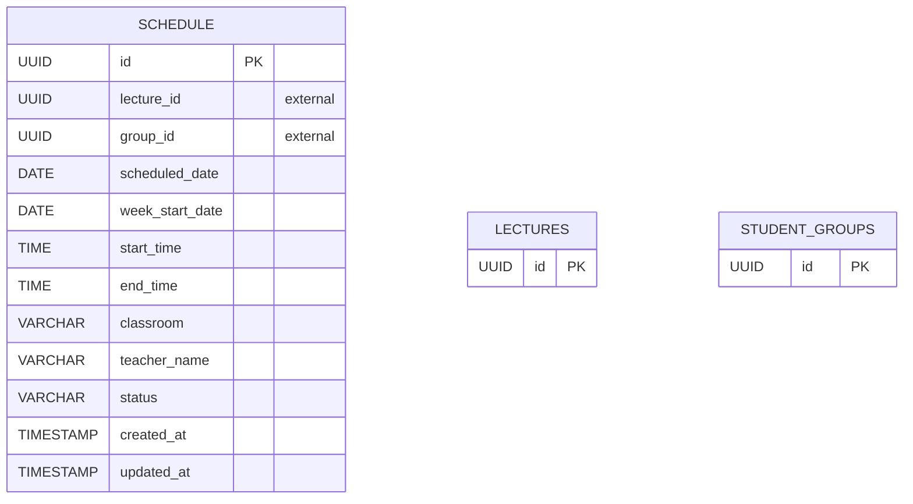
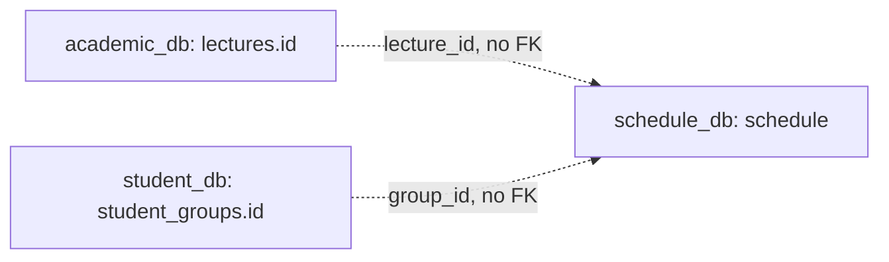
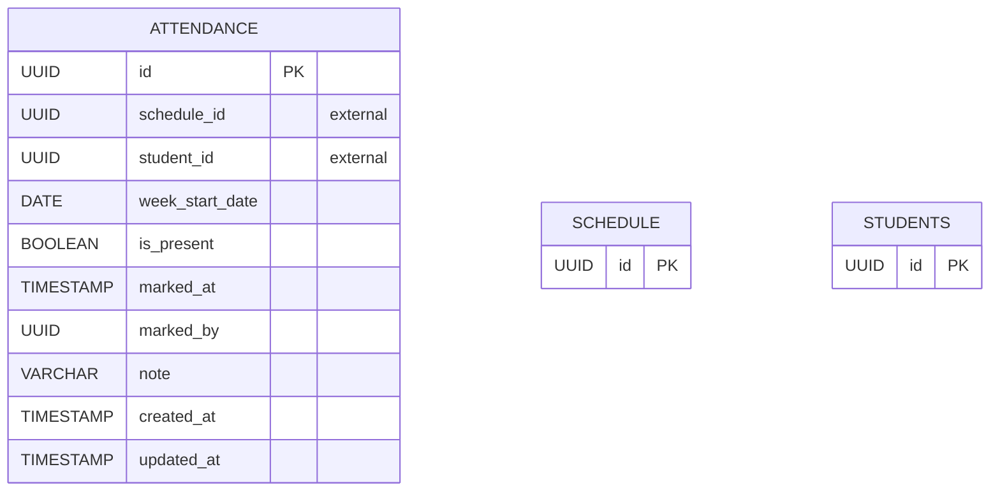
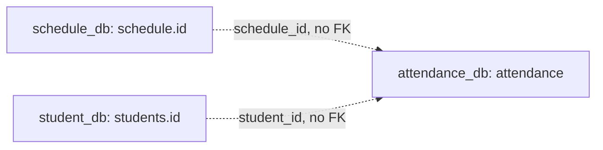

# University Production System — data model

## Общая ER-модель всех сервисов

В общей диаграмме межсервисные связи подписаны как `external`



## Общая модель системы



## Физические правила PostgreSQL v0.1

Полная физическая модель находится в [databases/postgresql/PHYSICAL_MODEL.md](databases/postgresql/PHYSICAL_MODEL.md).

### Основные типы

- Все идентификаторы: `UUID PRIMARY KEY DEFAULT gen_random_uuid()`.
- `created_at`, `updated_at`, `marked_at`: `TIMESTAMPTZ NOT NULL DEFAULT now()`; время хранится в UTC.
- Годы, семестры, длительности и часы: `SMALLINT` с соответствующими `CHECK`.
- Статусы и типы: `VARCHAR` с `CHECK`, PostgreSQL `ENUM` не используется.
- Метаданные материалов: `JSONB NOT NULL DEFAULT '{}'`.
- Обязательные поля: `NOT NULL`.
- `updated_at` обновляется приложением или общим trigger'ом.

### Настоящие PostgreSQL FK

```text
academic_db:
  institutes.university_id -> universities.id
  departments.institute_id -> institutes.id
  department_specialties.department_id -> departments.id
  department_specialties.specialty_id -> specialties.id
  lecture_courses.specialty_id -> specialties.id
  lectures.course_id -> lecture_courses.id
  lecture_materials.lecture_id -> lectures.id

student_db:
  students.group_id -> student_groups.id
```

### Межсервисные external UUID без FK

```text
student_db:
  student_groups.specialty_id -> academic_db.specialties.id
  student_groups.department_id -> academic_db.departments.id

schedule_db:
  schedule.lecture_id -> academic_db.lectures.id
  schedule.group_id -> student_db.student_groups.id

attendance_db:
  attendance.schedule_id -> schedule_db.schedule.id
  attendance.student_id -> student_db.students.id
  attendance.marked_by -> будущая auth-система
```

### Важные физические решения

- `department_specialties` использует составной PK `(department_id, specialty_id)` и `ON DELETE CASCADE`.
- Для одной специальности разрешена только одна primary-кафедра через partial unique index.
- Для `attendance` используется `PRIMARY KEY (id, week_start_date)` как подготовка к партиционированию по `week_start_date`.
- Все остальные удаления и FK используют безопасный `ON DELETE RESTRICT`, если это не таблица связи или подчинённый учебный контент.

## `academic_db`


Полный `content_text` и произвольный `metadata` материала хранятся в MongoDB
в коллекции `academic_content.lecture_material_contents`. `_id` документа равен
UUID строки `lecture_materials`, а PostgreSQL `content_ref` явно указывает на
этот документ. Публичный REST API объединяет обе записи и сохраняет прежний
контракт.

Elasticsearch содержит только поисковую проекцию лекции: `title`, `annotation`,
`content_text`, `lecture_type` и `course`. Источником текста остаётся MongoDB,
а структурированных связей — PostgreSQL.

Ограничение для таблицы `department_specialties`:

```text
UNIQUE (department_id, specialty_id)
```

## `student_db`

`specialty_id` и `department_id` — внешние UUID из `academic_db`, поэтому это не PostgreSQL `FOREIGN KEY`.



`SPECIALTIES` на этой диаграмме — внешний справочный объект, физически расположенный в `academic_db`.


## `schedule_db`

`lecture_id` и `group_id` — внешние UUID из `academic_db` и `student_db`. `course_id` намеренно отсутствует: курс определяется через `lecture_id`.





## `attendance_db`

`schedule_id` и `student_id` — внешние UUID из `schedule_db` и `student_db`.





Ограничение для таблицы `attendance`:

```text
UNIQUE (schedule_id, student_id, week_start_date)
```

## Redis-проекция студента

PostgreSQL `student_db` остаётся источником истины. `student-service` применяет
cache-aside только для получения одного студента по уникальному
`student_card_number`:

```text
student:card:{student_card_number} -> полный публичный Student JSON
TTL = STUDENT_CACHE_TTL_SECONDS (по умолчанию 86400 секунд / 24 часа)
```

При промахе или недоступности Redis выполняется запрос в PostgreSQL. После
создания или изменения студента значение записывается в кэш, а при изменении
номера или удалении старый ключ инвалидируется.

## Neo4j-проекция структуры, студентов и расписания

PostgreSQL-базы остаются источниками истины. Каждый сервис проецирует в Neo4j
собственные сущности:

```text
(University)-[:HAS_INSTITUTE]->(Institute)
  -[:HAS_DEPARTMENT]->(Department)
  -[:OFFERS_SPECIALTY]->(Specialty)

(Department)-[:HAS_GROUP]->(StudentGroup)
(StudentGroup)-[:STUDIES_SPECIALTY]->(Specialty)
(StudentGroup)-[:HAS_STUDENT]->(Student)
(StudentGroup)-[:HAS_SCHEDULE]->(Schedule)
```

Курсы, лекции и посещаемость в Neo4j не сохраняются. Узлы имеют уникальные
ограничения по UUID. Academic-, student- и schedule-service при старте
синхронизируют только свою часть графа, не удаляя узлы других доменов;
дальнейшие CRUD-операции обновляют проекцию через `MERGE`. Graph API позволяют
получить студентов университета, университет и группу студента, а также
расписание студента без чтения PostgreSQL.
