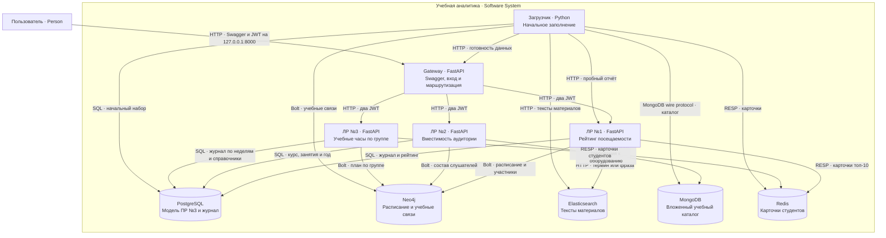
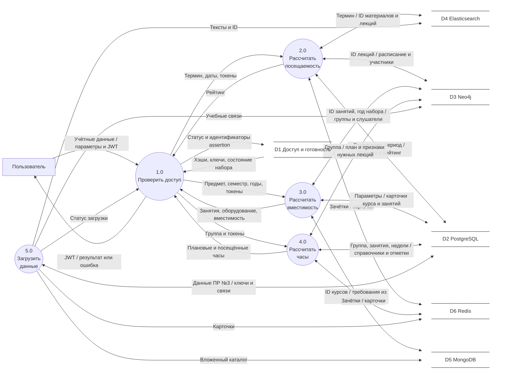

# Архитектура аналитики ПР №3 и ЛР №1–3

## C4 Containers

В Docker каждый отчёт работает в своём контейнере. У Gateway есть пользовательский JWT. Для маршрутизации он получает короткоживущий сервисный JWT с аудиторией конкретного отчёта, а отчёт проверяет обе подписи. Общее право чтения у существующих пользователей сохраняется под именем `lab1:read`.

## DFD Йордана–Кода

Круг обозначает процесс, прямоугольник — внешнюю сущность, две горизонтальные линии — хранилище.

