# Архитектура University Production System

Этот документ описывает текущее устройство проекта. PostgreSQL-модели,
миграции и код сервисов являются исполняемым источником истины; документ
фиксирует принятые границы, связи и эксплуатационные правила.

## 1. Контекст и границы

Система реализована как микросервисный backend на FastAPI. Клиент обращается
только к API Gateway. Каждый предметный сервис владеет своей логической
PostgreSQL-базой и не выполняет SQL-запросы в базы других сервисов.

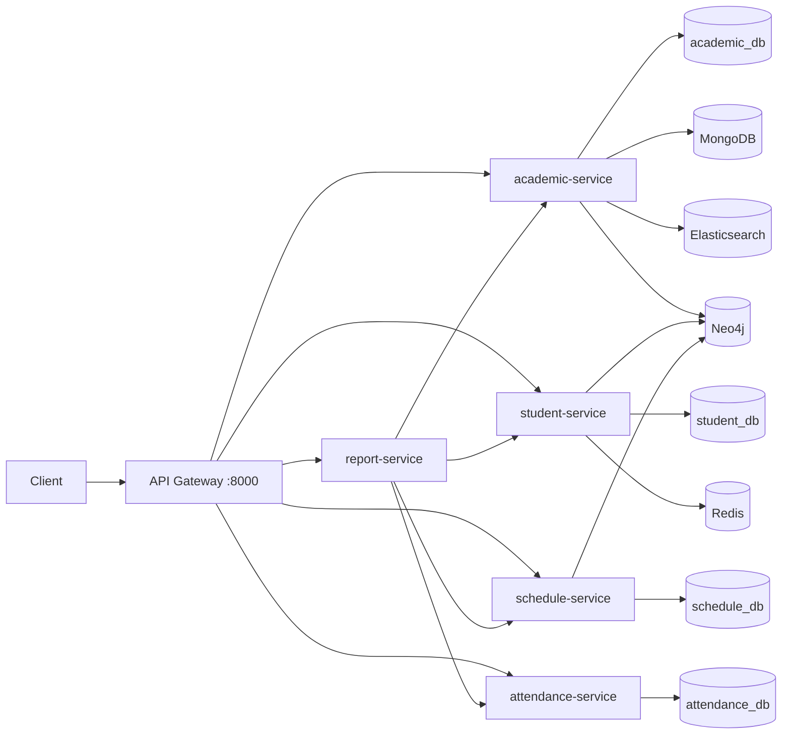

### Владение данными

| Компонент | Основные данные | Дополнительные хранилища |
|---|---|---|
| `academic-service` | университеты, институты, кафедры, специальности, курсы, лекции, материалы | MongoDB, Elasticsearch, Neo4j |
| `student-service` | группы и студенты | Redis, Neo4j |
| `schedule-service` | расписание | Neo4j |
| `attendance-service` | посещаемость | — |
| `report-service` | вычисляет отчёт ЛР1 по данным сервисов | собственной БД нет |
| `gateway` | выдача и проверка JWT, проксирование, объединённый OpenAPI | development-файл пользователей |

Разрешённое межсервисное взаимодействие:

```text
service A -> REST -> service B
service A -> events -> service B        # после реализации RabbitMQ
```

Запрещённое взаимодействие:

```text
service A -> SQL -> database B
```

## 2. Сеть и внешний доступ

В Compose используются две сети:

- `services-network` — Gateway и внутренние HTTP API;
- `database-network` — сервисы и хранилища, сеть помечена как internal.

Предметные сервисы используют `expose`, но не публикуют порт на host. Единой
внешней точкой API является Gateway. PostgreSQL и web-интерфейсы хранилищ
публикуются только для локальной разработки.

Маршрутизация Gateway:

```text
/api/v1/academic/*   -> academic-service
/api/v1/students/*   -> student-service
/api/v1/schedule/*   -> schedule-service
/api/v1/attendance/* -> attendance-service
/api/v1/reports/*    -> report-service
```

### Отчёт ЛР1

`GET /api/v1/reports/attendance/lowest` принимает `term`, `date_from`,
`date_to`, `search_mode` (`words` или `phrase`), а также необязательные UUID
кафедры, специальности, курса и группы. Report-service получает данные только
через API сервисов-владельцев. Поиск в Elasticsearch возвращает уникальные ID
лекций через composite aggregation с курсором; пакетные фильтры сервисов и
пагинация обрабатывают все результаты. Все слова должны совпасть в одном
проиндексированном документе лекции; `phrase` учитывает порядок токенов.

В расчёт попадают занятия типа `lecture` со статусом `completed`, в выбранном
периоде, не позже текущего времени по `REPORT_TIMEZONE` и не раньше даты
зачисления студента. Текущий состав групп применяется ко всему периоду; история
переходов не хранится. Нет отметки — пропуск. Обнаруженная при выборке запись с
недостоверной неделей приводит к ошибке. Отметка, ошибочно сохранённая за
неделю вне диапазона выборки, может остаться незамеченной; необходим аудит
старых данных. Процент = 100 × присутствий /
число лекций; сортировка до округления, при равенстве — UUID. Отчёт не более
чем на 10 студентов включает карточки студента и группы, входной термин и
период, процент и количества.

Elasticsearch обновляется best-effort и может отставать от источника: отчёт
отражает доступную поисковую проекцию и не даёт транзакционного снимка данных
разных сервисов. При недоступности источника возвращается ошибка, а не частичный
рейтинг. Изменение количества записей между страницами приводит к ошибке;
прочие параллельные изменения могут повлиять на результат.

Gateway передаёт `X-Request-ID`, ограничивает время upstream-запроса и
возвращает `503`, если зависимый сервис недоступен. Универсальный proxy-route не
публикуется в документации: Gateway получает OpenAPI внутренних сервисов и
объединяет их в один контракт `/openapi.json`.

## 3. Аутентификация

`POST /api/v1/auth/token` проверяет Argon2-хэш development-пользователя и
выдаёт JWT. Gateway проверяет подпись, issuer, audience и срок действия для всех
proxy API. Ролей пока нет: любой действительный access token предоставляет
одинаковый доступ. Предметные сервисы не выдают JWT.

Файл `gateway/config/dev-users.json` предназначен только для development. В
production его должен заменить внешний identity provider или секретный volume.

## 4. Логическая модель

Сплошные связи ниже являются PostgreSQL FK внутри одной базы. Связи с пометкой
`external UUID` проверяются через API владельца и физическим FK не являются.

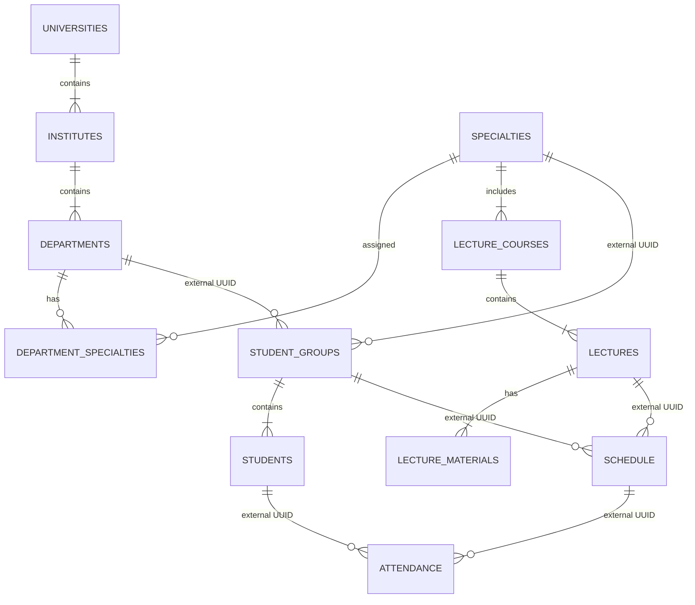

### Общие физические правила PostgreSQL

- идентификаторы — `UUID`, обычно `DEFAULT gen_random_uuid()`;
- временные поля — `TIMESTAMPTZ`, значения хранятся в UTC;
- обязательные поля имеют `NOT NULL`;
- изменяемые статусы представлены `VARCHAR + CHECK`, а не PostgreSQL ENUM;
- FK и часто используемые external UUID индексируются явно;
- `updated_at` обновляется приложением;
- каждый сервис имеет собственные Alembic migrations и отдельного владельца БД.

### `academic_db`

| Таблица | Основные поля | Ключевые правила |
|---|---|---|
| `universities` | `id`, `name`, `short_name`, `address`, `website`, `founded_year`, timestamps | `founded_year > 0`, если задан |
| `institutes` | `id`, `university_id`, `name`, `short_name`, `dean`, timestamps | FK на `universities`, `ON DELETE RESTRICT` |
| `departments` | `id`, `institute_id`, `name`, `short_name`, `head`, `room`, timestamps | FK на `institutes`, `ON DELETE RESTRICT` |
| `specialties` | `id`, `name`, `code`, `degree_level`, `duration_years`, timestamps | уникальный `code`; degree: bachelor/master/specialist |
| `department_specialties` | `department_id`, `specialty_id`, `is_primary`, `created_at` | составной PK; каскадное удаление; одна primary-кафедра на специальность |
| `lecture_courses` | `id`, `specialty_id`, `name`, `description`, `semester`, часы, timestamps | semester 1..12; сумма компонент не больше `total_hours` |
| `lectures` | `id`, `course_id`, `title`, `annotation`, `lecture_type`, `order_number`, `duration_minutes`, `requirements`, timestamps | уникально `(course_id, order_number)`; каскад от курса |
| `lecture_materials` | `id`, `lecture_id`, `content_type`, `title`, `file_url`, `content_ref`, timestamps | должен быть `content_ref` или `file_url`; каскад от лекции |

Допустимые `content_type`: `text`, `presentation`, `pdf`, `video_link`,
`code_sample`, `exercise`. Бинарные файлы в текущем объёме проекта не
загружаются: `file_url` остаётся внешней ссылкой.

### `student_db`

| Таблица | Основные поля | Ключевые правила |
|---|---|---|
| `student_groups` | `id`, external `specialty_id`, external `department_id`, `name`, `enrollment_year`, `curator`, timestamps | уникальное имя; положительный год; индексы external UUID |
| `students` | `id`, `group_id`, ФИО, `email`, `phone`, `student_card_number`, `enrollment_date`, `status`, timestamps | FK на группу с RESTRICT; уникальные email и номер билета |

Допустимые статусы студента: `active`, `academic_leave`, `expelled`,
`graduated`.

### `schedule_db`

Таблица `schedule` содержит `id`, external `lecture_id`, external `group_id`,
`scheduled_date`, `week_start_date`, время начала и окончания, аудиторию,
преподавателя, статус и timestamps.

Правила:

- `end_time > start_time`;
- `week_start_date` — понедельник;
- статус: `scheduled`, `completed` или `cancelled`;
- индексы по lecture, дате, началу недели и `(group_id, scheduled_date)`;
- `course_id` не дублируется и определяется через лекцию.

### `attendance_db`

Таблица `attendance` содержит `id`, external `schedule_id`, external
`student_id`, `week_start_date`, признак присутствия, `marked_at`, external
`marked_by`, примечание и timestamps.

Правила:

- RANGE-партиционирование по `week_start_date`, составной PK `(id, week_start_date)`;
- уникально `(schedule_id, student_id, week_start_date)`;
- `week_start_date` — понедельник;
- индексы по schedule, student и week;
- Attendance не хранится в Neo4j.

### Недельные партиции посещаемости

Миграция `20261031_partition_attendance` создаёт `attendance` с
`PARTITION BY RANGE (week_start_date)`. Партиции `attendance_w_YYYYMMDD`
охватывают интервал от понедельника включительно до следующего понедельника
исключительно. Миграция создаёт партиции для всех существующих недель и текущей
недели, переносит записи и восстанавливает PK, UNIQUE и индексы. Все действия
выполняются одной транзакцией под ACCESS EXCLUSIVE lock; обновление следует
проводить в окно обслуживания с остановленной записью. Нужен запас дискового
пространства для копии таблицы и индексов. Downgrade возвращает обычную таблицу
с сохранением данных.

Перед одиночным или пакетным PUT сервис в отдельной короткой транзакции вызывает
`ensure_attendance_partition(date)` для всех нужных недель. Advisory lock и
повторная проверка защищают создание от гонок между workers. Отдельная транзакция
не требует повышения блокировки после вставок внутри batch. Партиция может остаться
пустой, если последующая запись не удалась. Прямые SQL-вставки для новых недель
требуют предварительного вызова этой функции. DEFAULT-партиции нет.

Фильтр `week_start_date` в списке и журнале, а также `date_from`/`date_to` в
истории студента позволяют PostgreSQL исключать лишние партиции (partition
pruning). Запросы без ограничения недели могут читать все партиции.

### Граница физических FK

Настоящие FK существуют только внутри `academic_db` и между `students` и
`student_groups`. Межсервисные связи сохраняются как UUID без FK:

```text
student_groups.specialty_id  -> academic_db.specialties.id
student_groups.department_id -> academic_db.departments.id
schedule.lecture_id          -> academic_db.lectures.id
schedule.group_id            -> student_db.student_groups.id
attendance.schedule_id       -> schedule_db.schedule.id
attendance.student_id        -> student_db.students.id
attendance.marked_by         -> будущая auth-система
```

## 5. Polyglot persistence

PostgreSQL остаётся источником истины для структурированных данных. Остальные
хранилища имеют строго ограниченную ответственность.

### MongoDB: содержимое материалов

Коллекция: `academic_content.lecture_material_contents`.

```text
_id          = UUID материала
content_text = полный текст
metadata     = произвольные metadata
```

В PostgreSQL остаются структурированные поля материала и `content_ref`.
Academic-service объединяет PostgreSQL и MongoDB в публичный
`MaterialResponse`; внутренний `content_ref` клиенту не возвращается.

Создание и изменение материала выполняются драйвером academic-service. При
ошибке PostgreSQL сервис пытается компенсировать уже выполненную запись MongoDB.
Распределённой транзакции между хранилищами нет.

### Elasticsearch: поиск документов

Поисковая проекция создаётся в индексе `<ELASTICSEARCH_LECTURES_INDEX>_ru_v1`
(`lectures_ru_v1` по умолчанию). Анализатор `lecture_russian` применяет
стандартную токенизацию, приведение к нижнему регистру и встроенный русский
стеммер Elasticsearch. Стоп-слова не удаляются, чтобы сохранить их в поиске
фраз. Стемминг помогает сопоставлять словоформы, но не является словарной
лемматизацией и не гарантирует правильное совпадение всех форм.

При запуске с `PROJECTIONS_BOOTSTRAP_ON_STARTUP=true` сервис восстанавливает
новый индекс из PostgreSQL и MongoDB. Старый индекс без суффикса не удаляется.
В конфигурациях без bootstrap заполнение новой проекции необходимо обеспечить
перед использованием поиска. Несовместимый mapping нового индекса приводит к
ошибке, автоматического удаления индекса нет. До завершения восстановления
поисковая проекция может быть неполной; изменения в исходных хранилищах
сохраняются независимо от индекса.

Поисковый индекс содержит не карточки лекций, а отдельные документы:

- `description` — аннотация лекции;
- `material` — текст одного материала из MongoDB.

Строгий mapping:

```text
document_type : keyword
lecture_id    : keyword
material_id   : keyword, optional
content_type  : keyword, optional
content       : text, analyzer lecture_russian
```

Название курса, полная карточка лекции и metadata MongoDB в индекс не
копируются. Academic-service обновляет документы после CRUD и полностью
восстанавливает индекс при старте. При несовместимом mapping сервис сообщает об
ошибке и не удаляет индекс автоматически. Поиск доступен через:

```text
GET /api/v1/academic/search/documents
    ?q=...
    &document_type=description|material
    &lecture_id=...
    &content_type=...
    &limit=...
    &offset=...
```

### Redis: cache-aside студента

```text
student:card:{student_card_number} -> публичный Student JSON
TTL = STUDENT_CACHE_TTL_SECONDS, по умолчанию 86400 секунд
```

Первый запрос по номеру билета читает PostgreSQL и записывает кэш
(`X-Cache: MISS`), последующий получает `X-Cache: HIT`. Создание и изменение
студента обновляют запись; изменение номера и удаление инвалидируют старый
ключ. При недоступном Redis student-service продолжает читать PostgreSQL.

### Neo4j: связная read-модель

```text
(University)-[:HAS_INSTITUTE]->(Institute)
  -[:HAS_DEPARTMENT]->(Department)
  -[:OFFERS_SPECIALTY]->(Specialty)

(Department)-[:HAS_GROUP]->(StudentGroup)
(StudentGroup)-[:STUDIES_SPECIALTY]->(Specialty)
(StudentGroup)-[:HAS_STUDENT]->(Student)
(StudentGroup)-[:HAS_SCHEDULE]->(Schedule)
```

Владение проекцией разделено:

- academic-service — University, Institute, Department, Specialty;
- student-service — StudentGroup и Student;
- schedule-service — Schedule.

Каждый сервис при старте восстанавливает только собственную часть графа и не
очищает узлы других доменов. CRUD синхронизирует узлы и связи через `MERGE`.
Курсы, лекции и посещаемость в граф не переносятся.

Graph API:

```text
GET /api/v1/academic/graph/stats
GET /api/v1/academic/graph/universities/{university_id}
GET /api/v1/students/graph/universities/{university_id}/students
GET /api/v1/students/graph/students/{student_id}
GET /api/v1/schedule/students/{student_id}
```

Эти endpoints читают Neo4j. PostgreSQL остаётся источником для восстановления
проекции.

## 6. REST API и бизнес-правила

### Основные возможности

- Academic: CRUD университетской структуры, курсов, лекций и материалов;
  назначение специальностей кафедрам; материалы лекции; поиск документов.
- Students: CRUD групп и студентов; студенты группы; поиск по номеру билета;
  graph-запросы студент ↔ университет.
- Schedule: CRUD и фильтрация расписания; расписание группы и студента.
- Attendance: журнал занятия, история студента, одиночная и массовая
  идемпотентная отметка.

Collection endpoints используют `limit` и `offset`. Расписание поддерживает
фильтры дат. Запросы и ответы материалов, graph API и search API имеют явные
Pydantic-схемы в OpenAPI.

### Межсервисная валидация

- при создании группы проверяются кафедра и специальность;
- при создании расписания проверяются лекция и группа;
- специальность курса лекции должна совпадать со специальностью группы;
- Attendance можно отметить только студенту группы соответствующего занятия;
- межсервисные UUID проверяются через REST, а не SQL.

### Ошибки

Единый формат:

```json
{
  "error": {
    "code": "ERROR_CODE",
    "message": "Human-readable message",
    "details": {},
    "request_id": "..."
  }
}
```

Семантика статусов: `400` — бизнес-правило, `401` — аутентификация, `404` —
ресурс, `409` — конфликт, `422` — структура запроса, `503` — зависимость.

## 7. Миграции и запуск

Для каждой PostgreSQL-базы существует отдельный migration job. Сервис стартует
только после успешного `alembic upgrade head` и healthcheck необходимых
хранилищ. Проекции MongoDB, Elasticsearch и Neo4j инициализируются владельцами,
а не отдельным seeder-контейнером.

Healthcheck есть у Gateway, четырёх сервисов и инфраструктуры. Seeder ждёт
состояния healthy и работает исключительно через внутренние REST API.

## 8. Тестовый набор данных

Стандартный идемпотентный seed:

| Сущность | Количество |
|---|---:|
| Университеты / институты / кафедры / специальности | 2 / 4 / 8 / 8 |
| Курсы / лекции / материалы | 16 / 96 / 192 |
| Документы Elasticsearch | 288: 96 descriptions + 192 materials |
| Группы / студенты | 34 / 1000 |
| Занятия расписания / отметки | 408 / 4000 |
| Узлы / связи Neo4j в чистой базе | 1464 / 1496 |

В каждой группе не больше 30 студентов; по 500 seed-студентов относятся к
каждому университету. Даты начинаются с понедельника `2026-09-07` и охватывают
четыре недели.

Seeder использует детерминированные ключи с префиксом `SEED`, перед созданием
ищет существующие записи, обновляет изменившиеся материалы через PATCH и пишет
Attendance идемпотентным PUT. Он не получает пароли БД.

Verifier проверяет количества и бизнес-связи, MongoDB-контент, Elasticsearch
search, Redis HIT, Neo4j-цепочки и принадлежность Attendance студентам группы.
Дополнительные пользовательские данные не считаются ошибкой: производные
хранилища сравниваются со всеми актуальными источниками, а seed-подмножество —
с фиксированными ожидаемыми размерами.

## 9. Архитектурные инварианты

1. Публичный REST API меняется только при обоснованной необходимости.
2. Один сервис владеет одной предметной областью и своей PostgreSQL-базой.
3. Межсервисные связи — UUID без физических cross-database FK.
4. PostgreSQL — источник истины для структурированных данных.
5. MongoDB владеет неструктурированным содержимым материалов.
6. Elasticsearch, Neo4j и Redis — восстанавливаемые projection/read-model/cache.
7. Синхронный запрос с немедленным ответом использует REST; произошедший факт
   после появления брокера публикуется как событие.
8. UUID сохраняются одинаковыми во всех проекциях.
9. Correlation/request ID должен проходить через границы сервисов.
10. Новые лабораторные расширяют текущую архитектуру, не ломая контракты.

Дальнейшие работы и порядок развития находятся в [TODO.md](TODO.md).

## Приложение A. Полная логическая модель и контракты данных


### Общая ER-модель всех сервисов

В общей диаграмме межсервисные связи подписаны как `external`

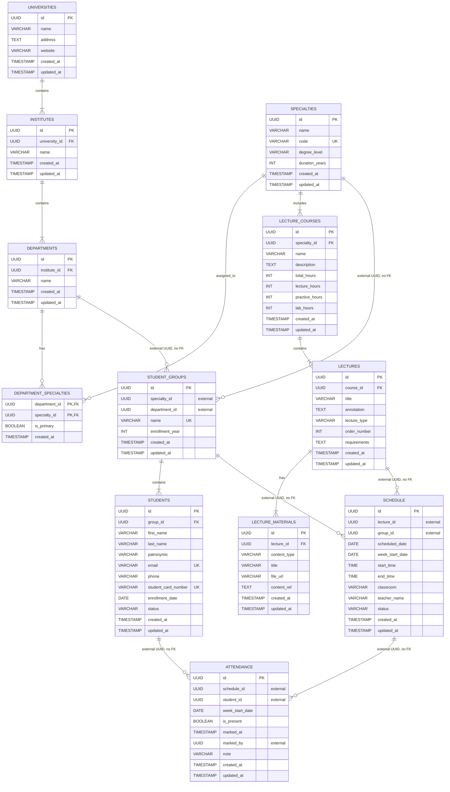

### Общая модель системы

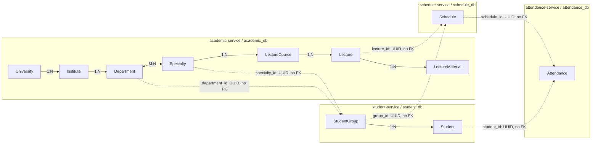

### Физические правила PostgreSQL v0.1

Полная физическая модель приведена в приложении B этого документа.

#### Основные типы

- Все идентификаторы: `UUID PRIMARY KEY DEFAULT gen_random_uuid()`.
- `created_at`, `updated_at`, `marked_at`: `TIMESTAMPTZ NOT NULL DEFAULT now()`; время хранится в UTC.
- Годы, семестры, длительности и часы: `SMALLINT` с соответствующими `CHECK`.
- Статусы и типы: `VARCHAR` с `CHECK`, PostgreSQL `ENUM` не используется.
- Метаданные материалов: `JSONB NOT NULL DEFAULT '{}'`.
- Обязательные поля: `NOT NULL`.
- `updated_at` обновляется приложением или общим trigger'ом.

#### Настоящие PostgreSQL FK

```text
academic_db:
  institutes.university_id -> universities.id
  departments.institute_id -> institutes.id
  department_specialties.department_id -> departments.id
  department_specialties.specialty_id -> specialties.id
  lecture_courses.specialty_id -> specialties.id
  lectures.course_id -> lecture_courses.id
  lecture_materials.lecture_id -> lectures.id

student_db:
  students.group_id -> student_groups.id
```

#### Межсервисные external UUID без FK

```text
student_db:
  student_groups.specialty_id -> academic_db.specialties.id
  student_groups.department_id -> academic_db.departments.id

schedule_db:
  schedule.lecture_id -> academic_db.lectures.id
  schedule.group_id -> student_db.student_groups.id

attendance_db:
  attendance.schedule_id -> schedule_db.schedule.id
  attendance.student_id -> student_db.students.id
  attendance.marked_by -> будущая auth-система
```

#### Важные физические решения

- `department_specialties` использует составной PK `(department_id, specialty_id)` и `ON DELETE CASCADE`.
- Для одной специальности разрешена только одна primary-кафедра через partial unique index.
- Для `attendance` используется `PRIMARY KEY (id, week_start_date)` как подготовка к партиционированию по `week_start_date`.
- Все остальные удаления и FK используют безопасный `ON DELETE RESTRICT`, если это не таблица связи или подчинённый учебный контент.

### `academic_db`
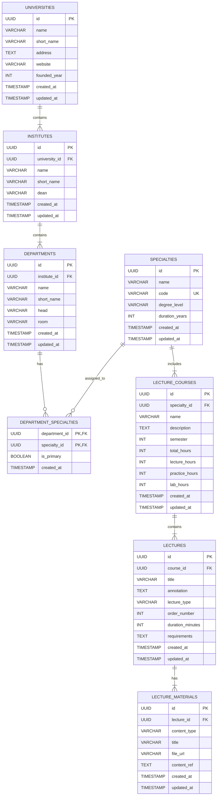

Полный `content_text` и произвольный `metadata` материала хранятся в MongoDB
в коллекции `academic_content.lecture_material_contents`. `_id` документа равен
UUID строки `lecture_materials`, а PostgreSQL `content_ref` явно указывает на
этот документ. Публичный REST API объединяет обе записи и сохраняет прежний
контракт.

Elasticsearch содержит только поисковые документы описаний лекций и текстовых
материалов. Строгий mapping включает `document_type`, `lecture_id`, опциональные
`material_id` и `content_type`, а также поле `content`. Описание и каждый
материал индексируются отдельно. Полная карточка лекции, курс и метаданные
MongoDB в индекс не копируются. API поиска читает только Elasticsearch.

Ограничение для таблицы `department_specialties`:

```text
UNIQUE (department_id, specialty_id)
```

### `student_db`

`specialty_id` и `department_id` — внешние UUID из `academic_db`, поэтому это не PostgreSQL `FOREIGN KEY`.

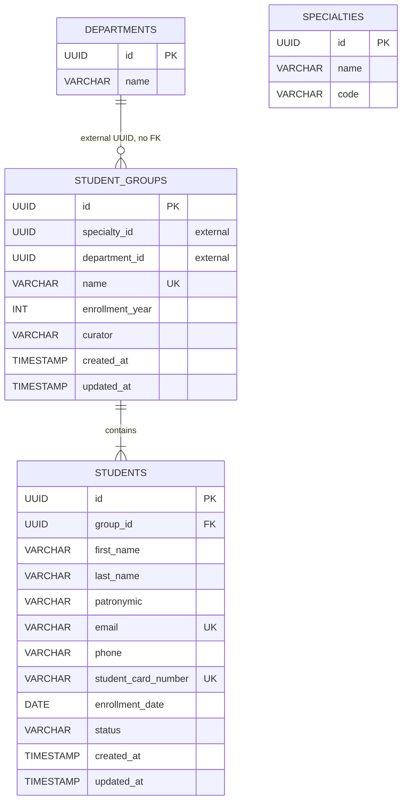

`SPECIALTIES` на этой диаграмме — внешний справочный объект, физически расположенный в `academic_db`.

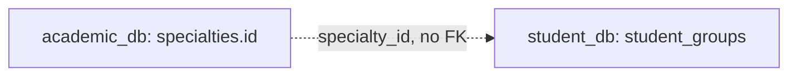

### `schedule_db`

`lecture_id` и `group_id` — внешние UUID из `academic_db` и `student_db`. `course_id` намеренно отсутствует: курс определяется через `lecture_id`.

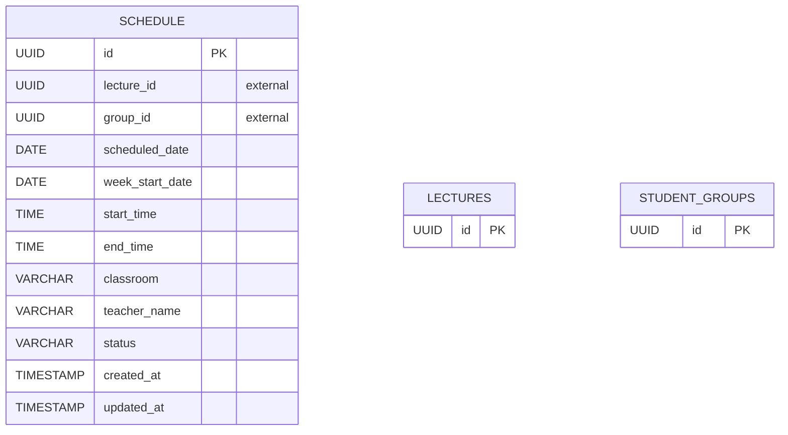

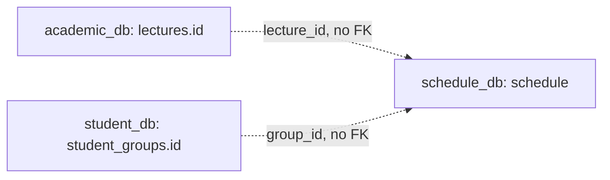

### `attendance_db`

`schedule_id` и `student_id` — внешние UUID из `schedule_db` и `student_db`.

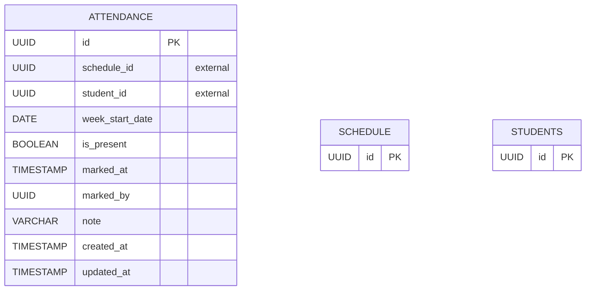

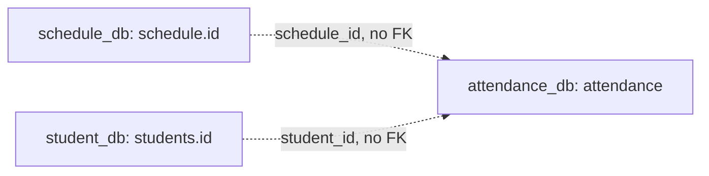

Ограничение для таблицы `attendance`:

```text
UNIQUE (schedule_id, student_id, week_start_date)
```

### Redis-проекция студента

PostgreSQL `student_db` остаётся источником истины. `student-service` применяет
cache-aside только для получения одного студента по уникальному
`student_card_number`:

```text
student:card:{student_card_number} -> полный публичный Student JSON
TTL = STUDENT_CACHE_TTL_SECONDS (по умолчанию 86400 секунд / 24 часа)
```

При промахе или недоступности Redis выполняется запрос в PostgreSQL. После
создания или изменения студента значение записывается в кэш, а при изменении
номера или удалении старый ключ инвалидируется.

### Neo4j-проекция структуры, студентов и расписания

PostgreSQL-базы остаются источниками истины. Каждый сервис проецирует в Neo4j
собственные сущности:

```text
(University)-[:HAS_INSTITUTE]->(Institute)
  -[:HAS_DEPARTMENT]->(Department)
  -[:OFFERS_SPECIALTY]->(Specialty)

(Department)-[:HAS_GROUP]->(StudentGroup)
(StudentGroup)-[:STUDIES_SPECIALTY]->(Specialty)
(StudentGroup)-[:HAS_STUDENT]->(Student)
(StudentGroup)-[:HAS_SCHEDULE]->(Schedule)
```

Курсы, лекции и посещаемость в Neo4j не сохраняются. Узлы имеют уникальные
ограничения по UUID. Academic-, student- и schedule-service при старте
синхронизируют только свою часть графа, не удаляя узлы других доменов;
дальнейшие CRUD-операции обновляют проекцию через `MERGE`. Graph API позволяют
получить студентов университета, университет и группу студента, а также
расписание студента без чтения PostgreSQL.

## Приложение B. Полная физическая модель PostgreSQL


Физическая модель является основой для SQLAlchemy 2.0 и Alembic для четырёх сервисов:

- `academic_db` — структура университета и учебный контент;
- `student_db` — группы и студенты;
- `schedule_db` — расписание;
- `attendance_db` — посещаемость.

### Общие правила

#### Идентификаторы и время

- Все идентификаторы имеют тип `UUID`.
- Значение по умолчанию для идентификаторов:

  ```sql
  UUID PRIMARY KEY DEFAULT gen_random_uuid()
  ```

- `created_at`, `updated_at` и `marked_at` имеют тип `TIMESTAMPTZ`.
- Значения времени хранятся в UTC.
- Для `created_at` и `updated_at` используется:

  ```sql
  TIMESTAMPTZ NOT NULL DEFAULT now()
  ```

- PostgreSQL не обновляет `updated_at` автоматически. Это будет реализовано в SQLAlchemy или общим trigger'ом.

#### Ограничения и индексы

- Для статусов используется `VARCHAR + CHECK`, а не PostgreSQL `ENUM`, чтобы значения можно было проще изменять миграциями.
- Все обязательные поля имеют `NOT NULL`.
- PostgreSQL не создаёт индекс на FK автоматически, поэтому нужные FK индексируются вручную.
- Межсервисные UUID также индексируются, если по ним выполняются запросы.
- Для удаления используются `RESTRICT`, если удаление родителя не должно каскадно удалять данные, и `CASCADE` для чистых таблиц связей и подчинённого учебного контента.

### `academic_db`

#### `universities`

| Поле | Тип | Ограничения |
|---|---|---|
| `id` | `UUID` | PK, `NOT NULL`, `DEFAULT gen_random_uuid()` |
| `name` | `VARCHAR(500)` | `NOT NULL` |
| `short_name` | `VARCHAR(100)` | nullable |
| `address` | `TEXT` | nullable |
| `website` | `VARCHAR(255)` | nullable |
| `founded_year` | `SMALLINT` | nullable |
| `created_at` | `TIMESTAMPTZ` | `NOT NULL`, `DEFAULT now()` |
| `updated_at` | `TIMESTAMPTZ` | `NOT NULL`, `DEFAULT now()` |

Ограничение:

```sql
CHECK (founded_year IS NULL OR founded_year > 0)
```

`name` не является `UNIQUE`: у организаций теоретически могут совпадать названия.

#### `institutes`

| Поле | Тип | Ограничения |
|---|---|---|
| `id` | `UUID` | PK |
| `university_id` | `UUID` | `NOT NULL`, FK |
| `name` | `VARCHAR(500)` | `NOT NULL` |
| `short_name` | `VARCHAR(100)` | nullable |
| `dean` | `VARCHAR(300)` | nullable |
| `created_at` | `TIMESTAMPTZ` | `NOT NULL`, `DEFAULT now()` |
| `updated_at` | `TIMESTAMPTZ` | `NOT NULL`, `DEFAULT now()` |

```sql
FOREIGN KEY (university_id)
REFERENCES universities(id)
ON DELETE RESTRICT

CREATE INDEX ix_institutes_university_id
ON institutes(university_id);
```

#### `departments`

| Поле | Тип | Ограничения |
|---|---|---|
| `id` | `UUID` | PK |
| `institute_id` | `UUID` | `NOT NULL`, FK |
| `name` | `VARCHAR(500)` | `NOT NULL` |
| `short_name` | `VARCHAR(100)` | nullable |
| `head` | `VARCHAR(300)` | nullable |
| `room` | `VARCHAR(50)` | nullable |
| `created_at` | `TIMESTAMPTZ` | `NOT NULL`, `DEFAULT now()` |
| `updated_at` | `TIMESTAMPTZ` | `NOT NULL`, `DEFAULT now()` |

```sql
FOREIGN KEY (institute_id)
REFERENCES institutes(id)
ON DELETE RESTRICT

CREATE INDEX ix_departments_institute_id
ON departments(institute_id);
```

#### `specialties`

| Поле | Тип | Ограничения |
|---|---|---|
| `id` | `UUID` | PK |
| `name` | `VARCHAR(500)` | `NOT NULL` |
| `code` | `VARCHAR(20)` | `NOT NULL`, `UNIQUE` |
| `degree_level` | `VARCHAR(20)` | `NOT NULL` |
| `duration_years` | `SMALLINT` | `NOT NULL` |
| `created_at` | `TIMESTAMPTZ` | `NOT NULL`, `DEFAULT now()` |
| `updated_at` | `TIMESTAMPTZ` | `NOT NULL`, `DEFAULT now()` |

```sql
CHECK (degree_level IN ('bachelor', 'master', 'specialist'))
CHECK (duration_years > 0)
```

Отдельный индекс на `code` не нужен: `UNIQUE` создаёт уникальный B-tree индекс.

#### `department_specialties`

| Поле | Тип | Ограничения |
|---|---|---|
| `department_id` | `UUID` | часть составного PK, `NOT NULL`, FK |
| `specialty_id` | `UUID` | часть составного PK, `NOT NULL`, FK |
| `is_primary` | `BOOLEAN` | `NOT NULL`, `DEFAULT false` |
| `created_at` | `TIMESTAMPTZ` | `NOT NULL`, `DEFAULT now()` |

```sql
PRIMARY KEY (department_id, specialty_id)

FOREIGN KEY (department_id)
REFERENCES departments(id)
ON DELETE CASCADE

FOREIGN KEY (specialty_id)
REFERENCES specialties(id)
ON DELETE CASCADE

CREATE INDEX ix_department_specialties_specialty_id
ON department_specialties(specialty_id);

CREATE UNIQUE INDEX uq_specialty_primary_department
ON department_specialties(specialty_id)
WHERE is_primary = true;
```

Отдельный `UNIQUE (department_id, specialty_id)` не нужен: эту уникальность уже гарантирует составной PK.

#### `lecture_courses`

| Поле | Тип | Ограничения |
|---|---|---|
| `id` | `UUID` | PK |
| `specialty_id` | `UUID` | `NOT NULL`, FK |
| `name` | `VARCHAR(500)` | `NOT NULL` |
| `description` | `TEXT` | nullable |
| `semester` | `SMALLINT` | `NOT NULL` |
| `total_hours` | `SMALLINT` | `NOT NULL` |
| `lecture_hours` | `SMALLINT` | `NOT NULL`, `DEFAULT 0` |
| `practice_hours` | `SMALLINT` | `NOT NULL`, `DEFAULT 0` |
| `lab_hours` | `SMALLINT` | `NOT NULL`, `DEFAULT 0` |
| `created_at` | `TIMESTAMPTZ` | `NOT NULL`, `DEFAULT now()` |
| `updated_at` | `TIMESTAMPTZ` | `NOT NULL`, `DEFAULT now()` |

```sql
CHECK (semester BETWEEN 1 AND 12)
CHECK (total_hours >= 0)
CHECK (lecture_hours >= 0)
CHECK (practice_hours >= 0)
CHECK (lab_hours >= 0)
CHECK (lecture_hours + practice_hours + lab_hours <= total_hours)

FOREIGN KEY (specialty_id)
REFERENCES specialties(id)
ON DELETE RESTRICT

CREATE INDEX ix_lecture_courses_specialty_id
ON lecture_courses(specialty_id);
```

#### `lectures`

| Поле | Тип | Ограничения |
|---|---|---|
| `id` | `UUID` | PK |
| `course_id` | `UUID` | `NOT NULL`, FK |
| `title` | `VARCHAR(500)` | `NOT NULL` |
| `annotation` | `TEXT` | nullable |
| `lecture_type` | `VARCHAR(20)` | `NOT NULL` |
| `order_number` | `SMALLINT` | `NOT NULL` |
| `duration_minutes` | `SMALLINT` | `NOT NULL`, `DEFAULT 90` |
| `requirements` | `TEXT` | nullable |
| `created_at` | `TIMESTAMPTZ` | `NOT NULL`, `DEFAULT now()` |
| `updated_at` | `TIMESTAMPTZ` | `NOT NULL`, `DEFAULT now()` |

```sql
CHECK (lecture_type IN ('lecture', 'practice', 'lab'))
CHECK (order_number > 0)
CHECK (duration_minutes > 0)
UNIQUE (course_id, order_number)

FOREIGN KEY (course_id)
REFERENCES lecture_courses(id)
ON DELETE CASCADE
```

Отдельный индекс на `course_id` не нужен: его покрывает индекс `UNIQUE (course_id, order_number)`.

#### `lecture_materials`

| Поле | Тип | Ограничения |
|---|---|---|
| `id` | `UUID` | PK |
| `lecture_id` | `UUID` | `NOT NULL`, FK |
| `content_type` | `VARCHAR(50)` | `NOT NULL` |
| `title` | `VARCHAR(500)` | nullable |
| `file_url` | `TEXT` | nullable |
| `content_ref` | `TEXT` | nullable, ссылка на MongoDB-документ |
| `created_at` | `TIMESTAMPTZ` | `NOT NULL`, `DEFAULT now()` |
| `updated_at` | `TIMESTAMPTZ` | `NOT NULL`, `DEFAULT now()` |

```sql
CHECK (content_type IN (
    'text', 'presentation', 'pdf', 'video_link', 'code_sample', 'exercise'
))

CHECK (
    content_ref IS NOT NULL
    OR file_url IS NOT NULL
)

FOREIGN KEY (lecture_id)
REFERENCES lectures(id)
ON DELETE CASCADE

CREATE INDEX ix_lecture_materials_lecture_id
ON lecture_materials(lecture_id);
```

`content_text` и `metadata` физически находятся в MongoDB, в коллекции
`academic_content.lecture_material_contents`. MongoDB `_id` совпадает с UUID
материала. `file_url` остаётся внешней ссылкой на бинарный объект; сами файлы
текущий API не принимает и не хранит.

### `student_db`

#### `student_groups`

| Поле | Тип | Ограничения |
|---|---|---|
| `id` | `UUID` | PK |
| `specialty_id` | `UUID` | `NOT NULL`, external, без FK |
| `department_id` | `UUID` | `NOT NULL`, external, без FK |
| `name` | `VARCHAR(50)` | `NOT NULL`, `UNIQUE` |
| `enrollment_year` | `SMALLINT` | `NOT NULL` |
| `curator` | `VARCHAR(300)` | nullable |
| `created_at` | `TIMESTAMPTZ` | `NOT NULL`, `DEFAULT now()` |
| `updated_at` | `TIMESTAMPTZ` | `NOT NULL`, `DEFAULT now()` |

Обе внешние ссылки являются обычными `UUID` без `REFERENCES`.

```sql
CHECK (enrollment_year > 0)

CREATE INDEX ix_student_groups_specialty_id
ON student_groups(specialty_id);

CREATE INDEX ix_student_groups_department_id
ON student_groups(department_id);
```

#### `students`

| Поле | Тип | Ограничения |
|---|---|---|
| `id` | `UUID` | PK |
| `group_id` | `UUID` | `NOT NULL`, FK |
| `first_name` | `VARCHAR(100)` | `NOT NULL` |
| `last_name` | `VARCHAR(100)` | `NOT NULL` |
| `patronymic` | `VARCHAR(100)` | nullable |
| `email` | `VARCHAR(255)` | nullable, `UNIQUE` |
| `phone` | `VARCHAR(30)` | nullable |
| `student_card_number` | `VARCHAR(50)` | nullable, `UNIQUE` |
| `enrollment_date` | `DATE` | `NOT NULL` |
| `status` | `VARCHAR(20)` | `NOT NULL`, `DEFAULT 'active'` |
| `created_at` | `TIMESTAMPTZ` | `NOT NULL`, `DEFAULT now()` |
| `updated_at` | `TIMESTAMPTZ` | `NOT NULL`, `DEFAULT now()` |

```sql
FOREIGN KEY (group_id)
REFERENCES student_groups(id)
ON DELETE RESTRICT

CHECK (status IN ('active', 'academic_leave', 'expelled', 'graduated'))

CREATE INDEX ix_students_group_id
ON students(group_id);
```

Индекс по `(last_name, first_name)` можно добавить позднее, если появится подтверждённая потребность в поиске по ФИО.

### `schedule_db`

`course_id` намеренно отсутствует: курс определяется через цепочку `schedule.lecture_id → academic_db.lectures.course_id`.

#### `schedule`

| Поле | Тип | Ограничения |
|---|---|---|
| `id` | `UUID` | PK |
| `lecture_id` | `UUID` | `NOT NULL`, external, без FK |
| `group_id` | `UUID` | `NOT NULL`, external, без FK |
| `scheduled_date` | `DATE` | `NOT NULL` |
| `week_start_date` | `DATE` | `NOT NULL` |
| `start_time` | `TIME` | `NOT NULL` |
| `end_time` | `TIME` | `NOT NULL` |
| `classroom` | `VARCHAR(50)` | nullable |
| `teacher_name` | `VARCHAR(300)` | nullable |
| `status` | `VARCHAR(20)` | `NOT NULL`, `DEFAULT 'scheduled'` |
| `created_at` | `TIMESTAMPTZ` | `NOT NULL`, `DEFAULT now()` |
| `updated_at` | `TIMESTAMPTZ` | `NOT NULL`, `DEFAULT now()` |

`lecture_id` и `group_id` проверяются приложением через соответствующие сервисы.

```sql
CHECK (end_time > start_time)
CHECK (status IN ('scheduled', 'completed', 'cancelled'))
CHECK (EXTRACT(ISODOW FROM week_start_date) = 1)

CREATE INDEX ix_schedule_lecture_id
ON schedule(lecture_id);

CREATE INDEX ix_schedule_scheduled_date
ON schedule(scheduled_date);

CREATE INDEX ix_schedule_week_start_date
ON schedule(week_start_date);

CREATE INDEX ix_schedule_group_date
ON schedule(group_id, scheduled_date);
```

Отдельный индекс только на `group_id` не требуется: составной индекс `(group_id, scheduled_date)` подходит для запросов по одной группе.

### `attendance_db`

#### `attendance`

| Поле | Тип | Ограничения |
|---|---|---|
| `id` | `UUID` | часть составного PK |
| `schedule_id` | `UUID` | `NOT NULL`, external, без FK |
| `student_id` | `UUID` | `NOT NULL`, external, без FK |
| `week_start_date` | `DATE` | часть составного PK, `NOT NULL` |
| `is_present` | `BOOLEAN` | `NOT NULL`, `DEFAULT false` |
| `marked_at` | `TIMESTAMPTZ` | nullable |
| `marked_by` | `UUID` | nullable, external, без FK |
| `note` | `VARCHAR(500)` | nullable |
| `created_at` | `TIMESTAMPTZ` | `NOT NULL`, `DEFAULT now()` |
| `updated_at` | `TIMESTAMPTZ` | `NOT NULL`, `DEFAULT now()` |

Для RANGE-партиционирования по `week_start_date` используется составной первичный ключ:

```sql
PRIMARY KEY (id, week_start_date)

UNIQUE (schedule_id, student_id, week_start_date)

CHECK (EXTRACT(ISODOW FROM week_start_date) = 1)
```

`schedule_id` и `student_id` ссылаются на другие БД логически, но не объявляются PostgreSQL FK. `marked_by` — UUID пользователя из будущей auth-системы.

Индексы:

```sql
CREATE INDEX ix_attendance_schedule_id
ON attendance(schedule_id);

CREATE INDEX ix_attendance_student_id
ON attendance(student_id);

CREATE INDEX ix_attendance_week_start_date
ON attendance(week_start_date);
```

Отдельный составной индекс на `(schedule_id, student_id, week_start_date)` не нужен: его создаёт `UNIQUE`.

### Граница FK и external UUID

#### Настоящие PostgreSQL FK

```text
academic_db:
  institutes.university_id -> universities.id
  departments.institute_id -> institutes.id
  department_specialties.department_id -> departments.id
  department_specialties.specialty_id -> specialties.id
  lecture_courses.specialty_id -> specialties.id
  lectures.course_id -> lecture_courses.id
  lecture_materials.lecture_id -> lectures.id

student_db:
  students.group_id -> student_groups.id
```

#### Межсервисные external UUID без FK

```text
student_db:
  student_groups.specialty_id -> academic_db.specialties.id
  student_groups.department_id -> academic_db.departments.id

schedule_db:
  schedule.lecture_id -> academic_db.lectures.id
  schedule.group_id -> student_db.student_groups.id

attendance_db:
  attendance.schedule_id -> schedule_db.schedule.id
  attendance.student_id -> student_db.students.id
  attendance.marked_by -> будущая auth-система
```

### Зафиксированные отклонения от логической ER-модели

1. `TIMESTAMP` в логической схеме физически реализуется как `TIMESTAMPTZ`.
2. Статусы реализуются через `VARCHAR + CHECK`, а не через PostgreSQL `ENUM`.
3. Для `attendance` используется `PRIMARY KEY (id, week_start_date)`, для партиционирования по `week_start_date`.
4. Для `department_specialties` используется составной PK `(department_id, specialty_id)`; отдельный дублирующий `UNIQUE` не нужен.
5. Для специальности добавлено правило: только одна кафедра может быть `is_primary = true`.

## Приложение C. Полный план настройки и заполнения данных


### 1. Границы работы

Работа выполняется только в рамках общего фундамента (`0`) и ЛР1 из
`TODO.md`. RabbitMQ, outbox, шардирование и репликация в bootstrap-процесс не
включаются. Seeder не подключается к специализированным хранилищам напрямую:
academic-service обновляет MongoDB, Elasticsearch и свою часть Neo4j,
student-service — Redis и узлы групп/студентов, schedule-service — узлы
расписания. Существующая JWT-реализация не расширяется.

### 2. Архитектурный принцип

Генератор данных не подключается к PostgreSQL и не выполняет SQL в базах
микросервисов. Он использует внутренние REST API сервисов:

```text
data-seeder
  ├── REST -> academic-service   -> academic_db + MongoDB + Elasticsearch + Neo4j
  ├── REST -> student-service    -> student_db + Redis cache + Neo4j
  ├── REST -> schedule-service   -> schedule_db + Neo4j
  └── REST -> attendance-service -> attendance_db
```

Так сохраняется правило владения данными: каждый сервис сам валидирует и
записывает принадлежащие ему сущности. Межсервисные UUID связываются через
ответы API, без SQL-доступа к чужим БД.

### 3. Целевой набор данных

| Сущность | Объём | Распределение |
|---|---:|---|
| Университеты | 2 | независимые учебные структуры |
| Институты | 4 | по 2 на университет |
| Кафедры | 8 | по 2 на институт |
| Специальности | 8 | по 1 на кафедру |
| Курсы | 16 | по 2 на специальность |
| Лекции | 96 | по 6 на курс |
| Материалы | 192 | по 2 на лекцию |
| Документы Elasticsearch | 288 | 96 описаний и 192 текстовых материала |
| Группы | 34 | по 17 на университет, не более 30 студентов |
| Студенты | 1000 | ровно по 500 на университет |
| Занятия расписания | 408 | 3 занятия × 4 недели × 34 группы |
| Отметки посещаемости | 4000 | одно занятие в неделю для каждого студента |
| Узлы Neo4j | 1464 | структура, 34 группы, 1000 студентов и 408 занятий |
| Связи Neo4j | 1496 | иерархия, группы, студенты и расписание |

Для каждого университета создаются 16 полных групп по 30 студентов и одна
группа из 20 студентов. Группы равномерно распределяются по специальностям.

Для каждой лекции создаются два содержательных Markdown-материала: конспект и
практическое задание. Темы охватывают архитектуру систем, моделирование данных,
транзакции, REST API, индексы и наблюдаемость. В metadata сохраняются язык,
формат, тема, ключевые слова, номер материала и оценка времени чтения.

### 4. Порядок загрузки

1. Дождаться `/health` всех четырёх сервисов.
2. Создать academic-граф в PostgreSQL и автоматически спроецировать его в Neo4j:
   `University -> Institute -> Department -> Specialty`.
3. Создать связи `Department <-> Specialty`.
4. Создать группы с UUID специальности и кафедры из academic-service.
5. Создать студентов и привязать их к группам; student-service кэширует их по
   номеру билета и проецирует группы и студентов в Neo4j.
6. Создать расписание только из лекций специальности соответствующей группы и
   спроецировать занятия группы в Neo4j.
7. Пакетно записать посещаемость студентов только для занятий их группы.
8. Выполнить проверку количества и связности через REST API.

### 5. Идемпотентность и воспроизводимость

- Все служебные коды, названия групп, email и номера студенческих билетов
  детерминированы и имеют префикс `SEED`.
- Перед `POST` генератор ищет существующую сущность по стабильному ключу.
- Существующие seed-материалы с тем же `material_number` обновляются через
  `PATCH`, если текст или metadata изменились; повторный запуск не создаёт копии.
- Attendance загружается идемпотентным `PUT`.
- Neo4j заполняется через `MERGE`; academic-, student- и schedule-service при
  старте независимо пересобирают принадлежащие им части графа из PostgreSQL.
  Посещаемость в граф не переносится.
- Redis работает по cache-aside: при промахе студент читается из PostgreSQL и
  кэшируется; при изменении или удалении кэш инвалидируется.
- Повторный запуск восстанавливает недостающие данные и не создаёт дубликаты.
- Даты расписания фиксированы и начинаются с понедельника `2026-09-07`.
- Присутствие рассчитывается детерминированно, без случайного состояния.

### 6. Подключение и запуск

Генератор оформляется отдельным Docker Compose service с профилем `tools`.
Он получает только URL внутренних сервисов и не получает пароли баз данных.

```bash
docker compose up -d --build
docker compose --profile tools build seed-data verify-data
docker compose --profile tools run --rm seed-data
docker compose --profile tools run --rm verify-data
```

Tools пересобираются после изменения `seeder.py`. Флаг `--build` у каждого
`run` не используется, чтобы повторно не пересобирать и не пересоздавать
зависимые сервисы.

Размер набора настраивается environment variables, но значения по умолчанию
должны создавать описанный выше набор из 1000 студентов.

### 7. Проверки готовности

- Docker Compose проходит валидацию.
- Все Alembic migration jobs завершаются успешно.
- Все сервисы отвечают на `/health`.
- Генератор завершается без HTTP/валидационных ошибок.
- Повторный запуск не меняет итоговые количества.
- В каждой группе не больше 30 студентов.
- Всего ровно 1000 seed-студентов и по 500 на университет.
- Все тексты и metadata материалов читаются через API из MongoDB.
- В PostgreSQL у материалов остаются только структурированные поля и ссылки.
- В Elasticsearch существуют отдельные документы описаний лекций и текстовых
  материалов; поиск по содержимому через REST API возвращает результаты.
- Студент доступен по уникальному `student_card_number`; повторный запрос
  обслуживается Redis, а при его недоступности используется PostgreSQL.
- В Neo4j существует структура, группы, студенты и расписание: 1464 узла и
  1496 связей для стандартного seed-набора в чистой базе. Verifier сверяет граф
  со всеми исходными PostgreSQL-базами и проверяет обходы студент ↔ университет,
  студент → группа и студент → расписание.
- Каждое занятие соответствует специальности группы.
- Каждая отметка принадлежит студенту группы занятия.
- `pytest`, Ruff и отдельная проверка набора проходят успешно.

### 8. Дополнительные необходимые работы

- Добавить healthcheck приложений в Compose, чтобы bootstrap ожидал реальную
  готовность, а не только запуск контейнера.
- Добавить `.env.example` без секретов.
- Документировать команды запуска, заполнения, проверки и полного пересоздания
  dev-окружения.
- Сохранить малые тесты API отдельно от объёмного bootstrap-набора.
